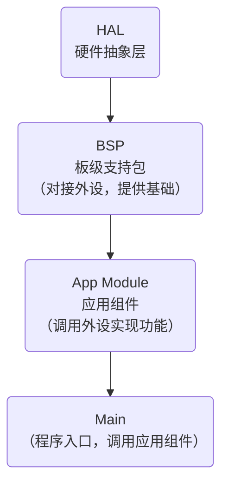

# pianotate

## 引脚配置&外设分配

参见`ovewview.pdf`，其中

1. GPIO Output：7个，用来控制LED
2. GPIO Input：7个，用来接收键盘输入
3. I2C：1*2个，挂载OLED屏幕和陀螺仪
4. TIM：2 Channel，控制双通道蜂鸣器
5. RCC：1*2个，板载晶振时钟输入
6. SYS：2个，用于连接烧录器调试
7. USART：1对*2个，用于调试，向外输出数据

## 软件架构

## 开发进度

- [ ] BSP
  - [ ] OLED（只处理基础功能）
  - [ ] 蜂鸣器
  - [ ] 陀螺仪
  - [ ] LED（打包成一个对象）
- [ ] App Module
  - [ ] 显示（图案绘制，动画）
  - [ ] 音乐（BPM设定，音调控制）
  - [ ] 4K 模式（状态机实现）
    - [ ] 按键中断
    - [ ] 判定
    - [ ] 谱面
  - [ ] 排行榜
  - [ ] 电子琴模式
- [ ] Main
  - [ ] 未完待续
